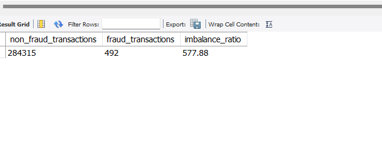
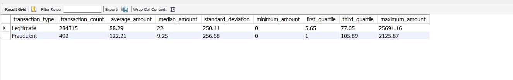
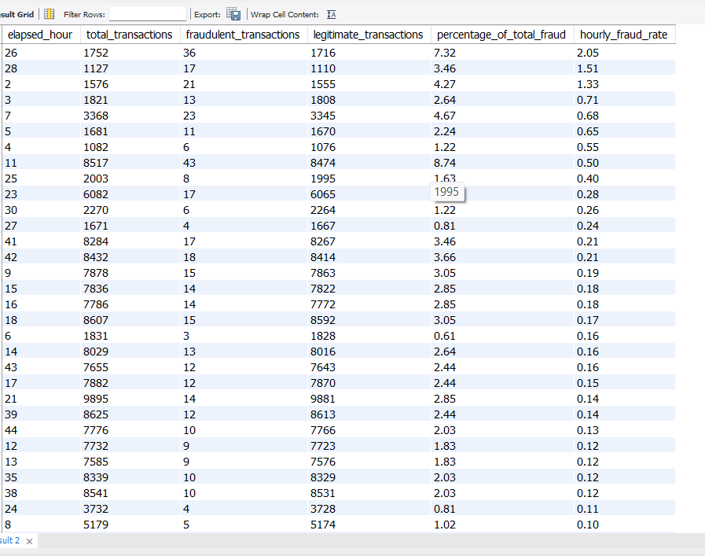
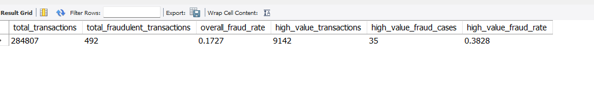

# Credit Card Fraud Pattern Detection with SQL

A MySQL analysis of anonymised credit-card transactions to explore fraud patterns, compare fraudulent and legitimate transaction amounts, examine elapsed-time intervals, evaluate high-value transactions, and demonstrate rolling-average analysis with a window function.

> **Purpose:** exploratory analysis and investigation support. The proposed signals are not a production fraud classifier and should not be used to automatically decline transactions without validation.

## Project at a glance

| | |
|---|---|
| **Dataset** | 284,807 transactions, 31 columns |
| **Database** | MySQL 8.0 (window functions required) |
| **Target** | `Class` — `0` legitimate, `1` fraudulent |
| **Analysis** | SQL data-quality checks, descriptive statistics, elapsed-hour rates, high-value fraud rates, rolling averages |
| **Source** | [Credit Card Fraud Detection dataset on Kaggle](https://www.kaggle.com/datasets/mlg-ulb/creditcardfraud) |

## Table of contents

- [Project objectives](#project-objectives)
- [Key findings](#key-findings)
- [Analysis evidence](#analysis-evidence)
- [Detailed findings](#detailed-findings)
- [Recommendations](#recommendations)
- [Dataset and limitations](#dataset-and-limitations)
- [Repository structure](#repository-structure)
- [Getting started](#getting-started)
- [Evaluation considerations](#evaluation-considerations)

## Project objectives

This project uses SQL to investigate four business questions:

1. How do transaction amount distributions differ between fraudulent and legitimate transactions?
2. Do fraud counts or fraud rates vary across elapsed-time intervals?
3. What proportion of transactions above 500 are fraudulent, compared with the overall fraud rate?
4. How does a transaction amount compare with a rolling average of recent transactions?

The analysis also considers duplicate records and the severe class imbalance in the dataset. SQL scripts are in [`sql/analysis/`](sql/analysis/), and the table definition is in [`sql/schema/schema _.sql`](sql/schema/schema%20_.sql).

## Key findings

- The dataset contains **284,315 legitimate transactions (99.83%)** and **492 fraudulent transactions (0.17%)**, or approximately **578 legitimate transactions per fraudulent transaction**.
- Fraudulent transactions have a higher mean amount (**122.21**) than legitimate transactions (**88.29**), but a lower median (**9.25** versus **22.00**). Amount alone is not a reliable classifier.
- **Elapsed hour 26** has the highest observed hourly fraud rate (**2.05%**); **elapsed hour 11** has the most fraud cases (**43**). These are different measures of risk and volume.
- Transactions above **500** have a fraud rate of **0.3828%**, around **2.22×** the overall rate of **0.1727%**. Nevertheless, most high-value transactions are legitimate.
- The rolling-average query demonstrates a way to surface amount deviations. It is not cardholder-specific, and its displayed output is limited to the first 1,000 transactions.

## Analysis evidence

The charts below are committed in the repository's [`images/`](images/) directory and provide visual evidence alongside the SQL analyses.

### Class imbalance



### Transaction amounts by class



### Fraud by elapsed time



### High-value transaction fraud rate



### Transaction amount and rolling average


## Detailed findings

### 1. Transaction amount distribution

The analysis compares count, mean, median, standard deviation, minimum, quartiles, and maximum by transaction class.

| Statistic | Legitimate | Fraudulent |
|---|---:|---:|
| Transaction count | 284,315 | 492 |
| Average amount | 88.29 | 122.21 |
| Median amount | 22.00 | 9.25 |
| Standard deviation | 250.11 | 256.68 |
| Minimum amount | 0.00 | 0.00 |
| First quartile (Q1) | 5.65 | 1.00 |
| Third quartile (Q3) | 77.05 | 105.89 |
| Maximum amount | 25,691.16 | 2,125.87 |

The higher fraud mean alongside the lower fraud median suggests that a subset of larger fraudulent transactions raises the average, while the typical fraudulent transaction is smaller. Variation is substantial in both classes, and the maximum legitimate amount is much larger. Transaction amount should therefore be considered with other indicators.

### 2. Fraud concentration across elapsed-time intervals

`Time` is elapsed seconds from the first recorded transaction. The query groups transactions into one-hour elapsed intervals; it does **not** represent clock time.

| Elapsed hour | Transactions | Fraud cases | Share of all fraud | Interval fraud rate |
|---:|---:|---:|---:|---:|
| 26 | 1,752 | 36 | 7.32% | 2.05% |
| 28 | 1,127 | 17 | 3.46% | 1.51% |
| 2 | 1,576 | 21 | 4.27% | 1.33% |
| 3 | 1,821 | 13 | 2.64% | 0.71% |
| 7 | 3,368 | 23 | 4.67% | 0.68% |
| 5 | 1,681 | 11 | 2.24% | 0.65% |
| 4 | 1,082 | 6 | 1.22% | 0.55% |
| 11 | 8,517 | 43 | 8.74% | 0.50% |

Elapsed hour 26 has the highest rate in the selected results, while hour 11 has the most fraud cases. Rates account for differences in transaction volume; counts describe case volume. These results show variation across elapsed-time intervals but cannot support conclusions about night, morning, or other real-world times of day.

### 3. High-value transactions

For this analysis, a high-value transaction is one with an amount **above 500**.

| Measurement | Result |
|---|---:|
| Total transactions | 284,807 |
| Fraudulent transactions | 492 |
| Overall fraud rate | 0.1727% |
| Transactions above 500 | 9,142 |
| Fraudulent transactions above 500 | 35 |
| High-value fraud rate | 0.3828% |

The high-value fraud rate is approximately **2.22 times** the overall rate. This makes high-value transactions a possible review signal, not proof of fraud: only 35 of 9,142 transactions above the threshold were fraudulent.

### 4. Rolling-average comparison

The window-function query orders transactions by `Time` and computes an average over the current row and up to five preceding rows. It reports the difference and percentage difference from the rolling average and labels each row as above, below, or equal to average.

The analysis illustrates how unusual amount changes can be surfaced for investigation. The displayed query output is limited to 1,000 rows, and the visible records were legitimate; this is not enough to conclude that fraudulent transactions deviate more often. Because there are no customer or card identifiers, the rolling window compares consecutive records across the dataset rather than a single cardholder's history.

## Recommendations

The findings motivate three **initial investigation signals**:

| Signal | Proposed monitoring trigger | Rationale and caution |
|---|---|---|
| High transaction amount | Review transactions above 500. | Observed high-value fraud rate is about 2.22× the overall rate, but most such transactions are legitimate. |
| Elapsed-time interval | Evaluate additional monitoring for elapsed hours 26, 28, and 2. | These intervals had the highest rates in the selected results; elapsed time is not clock time and the pattern needs validation. |
| Amount change | Investigate transactions substantially above a suitable recent-amount baseline. | Large deviations can be useful signals, but the available rolling average is global, not cardholder-specific. |

Treat these as **review triggers, not automatic declines**. Test them against historical labels, measure false positives, and tune thresholds before any operational use. Additional customer/card identifiers and a properly validated model may help capture individual behaviour and more complex patterns.

## Dataset and limitations

The project uses the public [Kaggle Credit Card Fraud Detection dataset](https://www.kaggle.com/datasets/mlg-ulb/creditcardfraud). Its fields include `Time`, `Amount`, anonymised features `V1`–`V28`, and `Class`. The raw dataset is not included in this repository; download it from Kaggle and follow its terms and access requirements.

Important limitations:

- **Severe class imbalance:** fraud represents only about 0.17% of records. Accuracy alone can be misleading; an always-legitimate classifier would still be about 99.83% accurate while detecting no fraud.
- **No customer/card identifiers:** customer-level spending baselines cannot be calculated.
- **Elapsed time, not clock time:** hourly groupings do not identify time of day.
- **Exploratory rolling window:** consecutive rows are compared across the whole dataset, not within a cardholder, and the query returns only 1,000 rows.
- **Association is not proof:** observed rates and patterns do not establish causes or guarantee future performance.

## Repository structure

```text
.
├── data/
│   └── raw/README.md                  # Dataset source; raw data is not committed
├── images/                            # Analysis charts and evidence
└── sql/
    ├── analysis/
    │   ├── distribution_of_transaction_amount_by_class.sql
    │   ├── fradulenttransaction_concentration_with_time.sql
    │   ├── high_value_transaction_fraud_rate.sql
    │   └── comparison _betweenn_rolling_average_and_transaction_amounts.sql
    └── schema/
        └── schema _.sql               # MySQL table definition
```

## Getting started

### Requirements

- MySQL **8.0 or later** (the analyses use common table expressions and window functions).
- The Kaggle CSV dataset, downloaded separately.
- A MySQL client such as MySQL Workbench or the `mysql` command-line client.

### 1. Create the database and table

Create a database, select it, then execute [`sql/schema/schema _.sql`](sql/schema/schema%20_.sql). The schema creates a `creditcard` table with the dataset columns; it does not load transaction rows.

```sql
CREATE DATABASE bankandfraudpatterndetection;
USE bankandfraudpatterndetection;
```

### 2. Load the dataset

Download the CSV from Kaggle and import its rows into `creditcard` using your MySQL client's CSV import workflow. Match the table's column order and types, and confirm the imported row count is 284,807 before running the analyses. Keep the downloaded dataset local; it is not tracked here.

### 3. Run the analyses

Run the SQL files in `sql/analysis/` against the selected database. Each script can be run independently and queries the `creditcard` table.

## Evaluation considerations

Any future rule or model should be assessed against labelled data with **precision, recall, F1-score, and false-positive rate**, in addition to transaction review capacity and operational impact. Validate thresholds on held-out data and monitor performance over time before deployment.

---

*This project is for educational and analytical purposes. It does not provide financial, legal, or production fraud-detection advice.*
